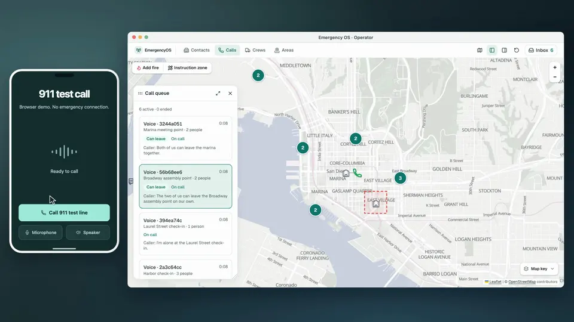
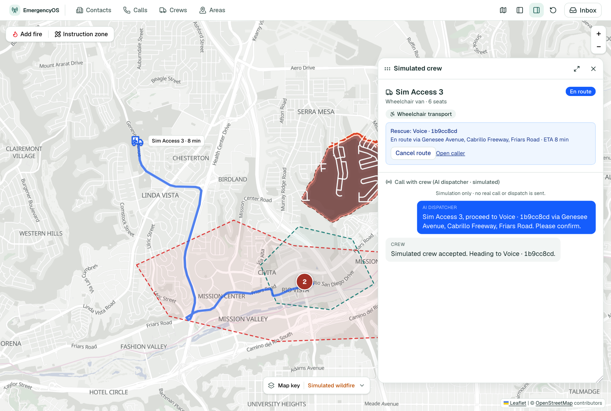

# Emergency OS

Emergency OS gives disaster-response operators a live map of calls for help. A voice agent asks where callers are and what they need. Operators can follow the transcript and update local instructions mid-call.

Six calls are already active when a caller reaches Emergency OS from San Diego Central Library, 330 Park Boulevard. The agent confirms the address, gives the library’s evacuation instruction and asks, “Can you leave on your own?” The caller answers, “No, I need assistance.” The library pin pulses and the request reaches the operator’s inbox.

[](docs/demo/library-call.mp4?raw=true)

**[Watch the 43-second call with sound](docs/demo/library-call.mp4?raw=true)** · [See the assistance ping](docs/demo/library-assistance.webp)

[](docs/demo/simulated-route.webp)

*In the Riverbend Hall exercise, Sim Access 3 has accepted the wheelchair pickup. The map shows the van’s route and an eight-minute ETA.* Map data © [OpenStreetMap contributors](https://www.openstreetmap.org/copyright).

A second agent handles clinic outreach. The operator finds a facility through an OpenStreetMap search and starts a browser conversation with a participant playing reception. The agent records the clinic’s reported needs alongside the words that support them.

David Emmanuel Assheuer led the team and built both ElevenLabs voice agents for the SDx × SDSU Voice Agent Hackathon. The React and TypeScript dashboard shares a FastAPI backend and SQLite database with both agents. [Voice intake evaluation (55 scenarios)](evaluation/README.md)

## Run locally

With Python 3.11+ and Node.js 22.12+ installed, run

```sh
./scripts/run-demo.sh
```

The [operator dashboard](http://localhost:8000/dashboard/) works without credentials. To try the [browser caller](http://localhost:8000/), follow the [ElevenLabs setup](docs/demo-api.md#voice-setup).

### Call from San Diego Central Library

```sh
./scripts/run-demo.sh --assistance-call
```

Open the [caller](http://127.0.0.1:8018/) and [operator map](http://127.0.0.1:8018/dashboard/?view=calls) in separate tabs. The exercise starts with six simulated calls and a published evacuation instruction for the library. The video replays a recorded ElevenLabs conversation in the running dashboard. [Voice and recording setup](docs/demo-api.md#record-the-central-library-call)

### Riverbend Hall wildfire exercise

Three people need a ride. The district’s pickup point is an upper plaza with stairs. One caller needs a wheelchair lift and can reach the lobby. As the operator, you choose where they should wait and send a simulated wheelchair van.

```sh
./scripts/run-demo.sh --dashboard-drill
```

Open [Riverbend Hall](http://127.0.0.1:8017/) and select the call in **Calls**. Read the [caller’s pickup request](docs/demo/caller-intake.webp). In **Inbox**, compare the [two published instructions](docs/demo/operator-inbox.webp) and choose **Use Hall access zone for this call**.

In **Crews**, start **Simulate AI crews**, select **Sim Access 3**, and choose **Simulate crew dispatch**. The exercise uses scripted dialogue and a fresh temporary database. You can run it without provider credentials.

[Watch the Riverbend pickup (21 seconds)](docs/demo/riverbend-drill.mp4?raw=true) · [See where the two instruction zones overlap](docs/demo/incident-map.webp)
