# Disaster-response crawler: OpenStreetMap implementation

Updated November 8, 2026. This follows the [disaster-response brainstorm](disaster-response-brainstorm.md).

## Current decision

The user explicitly requested an alternative that does not require creating an Apify account, suggesting OpenStreetMap. **The primary live provider is now OpenStreetMap via the public Overpass API.** This supersedes the earlier Apify-first proposal. The mock data/database separation, operator review, and later voice-agent handoff remain selected requirements.

The optional Apify adapter remains available for compatibility but is not used by OSM discovery. Google Places was considered, but its official API requires an enabled billing project and API key. We have not added an unofficial Google Maps scraper or another account-based intermediary.

## Working flow

```mermaid
flowchart LR
    A[Operator: incident, bounds, categories] --> B[Local or Daytona worker]
    B --> C[One bounded Overpass request]
    C --> D[OSM facilities and contact tags]
    D --> E[Local classification, normalization, deduplication]
    E --> F[JSON contacts, locations, evidence, attribution]
    F --> W[Optional website enrichment for missing phones]
    W --> G[Future dashboard review]
    G --> H[Future voice-agent handoff]
```

The shipped worker accepts explicit geographic bounds. A location label is not a geocoding request; the area selected in the future dashboard should provide the rectangle directly. The current provider supports one area per job. Named-place geocoding is a possible later addition, with its own provider usage policy and ambiguity review.

A single query covers the scheduled categories. Overpass returns nodes, ways, and relations with tags and coordinates/centers. Local workers classify and merge these results. This keeps public-service use small while still allowing parallel local processing.

## What is implemented

- Account-free Overpass HTTP adapter with fixed endpoint, bounded query area, response-size limit, query timeout, and element cap.
- Public `phone` and `contact:phone` values, including semicolon-separated lists, with conflicting candidates preserved.
- Facility names, mapped addresses, coordinates, websites, element source URLs, category evidence, and OSM attribution.
- Duplicate category hits merged by namespaced OSM element ID; shared reception numbers do not merge different facilities.
- Explicit missing-data, approximate-coordinate, out-of-bounds, closed-listing, and conflicting-contact flags.
- HTTP failures and Overpass HTTP-200 runtime errors distinguished from a successful empty result. Partial output is marked partial.
- One cached response/failure within the job, preventing parallel category tasks from issuing repeated requests. There is no persistent cache.
- Optional website enrichment visits the listed HTML page and follows contact/about/location links, extracts phone candidates with exact source URLs and excerpts, distinguishes explicit reception labels from general contacts, and records unresolved/error states. Existing numbers and conflicts are preserved.
- Existing mock provider, CLI JSON output, TypeScript contract, and optional Daytona launcher. OSM mode requires no Apify token.

The original JSON shape is retained with an additional `osm` source, optional OSM evidence fields, task warnings, and attribution metadata. See [the contract](../crawler/contracts/discovery.ts) and [setup instructions](../crawler/README.md).

## Category coverage

| Requested category | OSM matching approach | Interpretation |
| --- | --- | --- |
| Care home | Nursing-home amenity; social facilities tagged nursing home, group home, or assisted living | Listed institutional lead; current residents/needs unknown |
| Disability support | Social facility whose audience tag mentions disability or mental health | Potential support organization; mapped categories may be incomplete |
| Health clinic | Clinic, doctors, hospital, and corresponding healthcare tags | Includes hospitals as useful institutional contacts |
| Shelter | Social facility explicitly tagged shelter | Does not assume a general outdoor shelter is a staffed disaster shelter |
| Accessible transport | Taxi amenity marked wheelchair accessible | Weak resource lead; does not establish accessible vehicles, dispatch capability, or availability |
| Community organization | Community/social centers and NGO/charity offices | Possible local coordination/relay contact |

These are practical prototype mappings, not exhaustive discovery or a determination of eligibility, assistance capacity, or population coverage. The output retains matching tags so operators can assess relevance. Phone fields are frequently absent. A map listing cannot establish that someone is safe or that a number reaches reception.

## Validation

A live request for the example central San Diego rectangle completed with 37 facility leads, 13 containing unambiguous normalized phone contacts. It used one public Overpass request without an account or token. No phone calls were made and no facility availability was verified. The local Python trust-store setup needed `SSL_CERT_FILE=/etc/ssl/cert.pem`; TLS verification remained enabled.

Automated tests cover synthetic Overpass responses, one-request fan-out, duplicate categories, phone conflicts, extensions, nodes/ways/relations, attribution, geographic bounds, clipping, malformed responses, runtime errors, and rate-limit failure reuse, alongside the existing discovery and provider tests.

Actual Daytona account execution, Docker runtime, Supabase ingestion, dashboard display, and voice-agent calling remain separate unverified integrations. Local live discovery is verified; these other integrations are not implied by that result.

## Next integration steps

1. Import the mock JSON into the dashboard. For live jobs, pass the map-selected bounds with `sources: ["osm"]` and show attribution, source evidence, and unresolved contact gaps.
2. Add durable backend jobs, incident access control, append-only evidence, a shared response cache, and global request limits before scaling. A thread-pool limit does not limit other processes.
3. Run the same OSM request in the team's Daytona account and verify retrieval and sandbox cleanup. No additional search-provider credentials are needed.
4. Add an operator approval action that creates a separate, authorized voice task. The voice agent can confirm reception identity and current location, ask about unmet needs, and ask reception to relay approved callback information.
5. **Implemented:** enable `enrich_websites` to inspect listed websites for missing numbers. The bounded HTML crawler includes robots checks, public-IP validation with pinned connections, redirect/size limits, caching, and per-host spacing. It retains exact page/label evidence and marks branch ownership unverified. General public-directory lookup and JavaScript rendering remain future work.
6. Follow structured organization referrals carrying their parent conversation and purpose. Bound depth and work budgets, deduplicate, and stop when an operator decision is required.

Private-person discovery remains a separate proposed workflow using authorized rosters, inbound callbacks, or consented referrals. This worker returns public institutional contacts; it does not attach guessed internet phone matches to individuals.

## Public-service and licensing constraints

Public Overpass is shared infrastructure. The prototype submits one small bounded query per job and does not automatically retry rate limits or hop between servers. Repeated automated use needs a shared cache/queue; larger deployments should use a self-operated Overpass instance or regional OSM extracts. Public availability is not an emergency-service uptime guarantee.

Reports include **© OpenStreetMap contributors**, the copyright URL, and `ODbL-1.0`. Preserve these in dashboard and export views and follow the OSM license for redistributed databases. Source retrieval time is recorded; source-update time is unknown.

References checked November 8, 2026:

- [Overpass public-service guidance](https://dev.overpass-api.de/overpass-doc/en/preface/commons.html) and [bounding-box queries](https://dev.overpass-api.de/overpass-doc/en/full_data/bbox.html).
- [OSM phone tags](https://wiki.openstreetmap.org/wiki/Key:phone), [contact tags](https://wiki.openstreetmap.org/wiki/Key:contact), and [social facilities](https://wiki.openstreetmap.org/wiki/Key:social_facility).
- [OSM attribution and licensing](https://www.openstreetmap.org/copyright).
- [Google Places setup requirements](https://developers.google.com/maps/documentation/places/web-service/get-api-key).

## Website-enrichment behavior

The user explicitly requested checking facility websites for missing reception numbers and retaining the source. This is now an optional, account-free pass over the returned leads. It reads at most three pages per facility and 80 total HTTP requests per job, including robots and redirects. `tel:` links and labeled visible numbers are extracted; scripts are not run. Existing phone candidates are never overwritten. Synthetic leads never trigger network requests.

A site can expose a corporate switchboard, individual department numbers, or multiple branches. Candidates include the exact URL, local excerpt, extraction method, and a reception/main/general label. They remain unverified and require operator review. Multiple distinct numbers are retained as conflicts. Error reports distinguish robots exclusions, network/HTTP failure, unsupported formats, redirect limits, and budgets from successful pages without a number. The TypeScript contract includes these additive fields.
